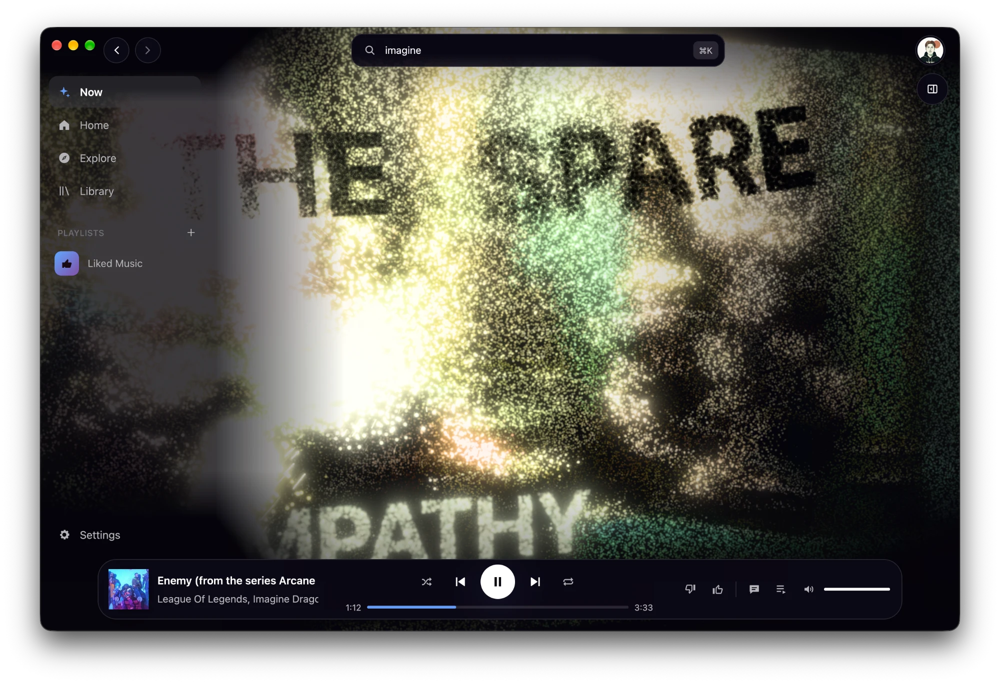
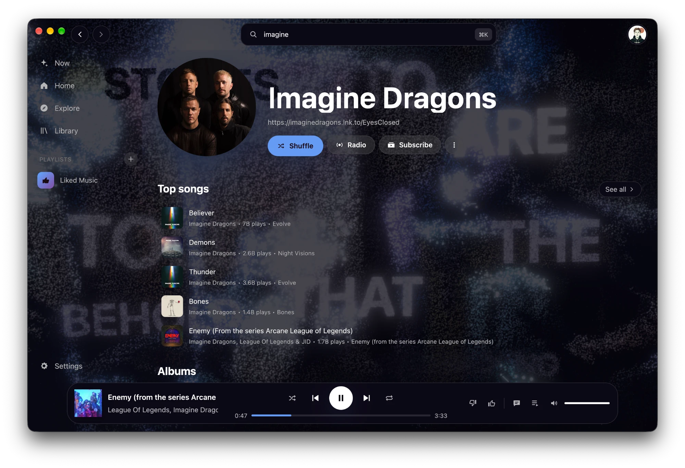

# Drift

A native macOS player for YouTube Music, where every song becomes a galaxy.



Drift wraps the real YouTube Music web app in a fast native interface written in Rust with
[GPUI](https://www.gpui.rs), and draws music-reactive visuals on the GPU with [wgpu](https://wgpu.rs):
a galaxy made from each song's cover art, lyrics spelled out in stars, music videos turned into
particles, a living desktop wallpaper and a Dynamic Island around the MacBook notch.

> Drift is an unofficial client. It is not affiliated with, endorsed by or sponsored by Google or
> YouTube. You need your own YouTube Music account.

## Features

- **Your YouTube Music, natively.** Home, Explore, Library, search with suggestions, artists, albums,
  playlists, the queue, lyrics, related music, radio, likes, and YouTube Music's own account settings.
- **Now.** The song's galaxy fills the window, with the queue, lyrics and related music beside it.
  The side column can be put away to leave the whole window to the galaxy.
- **A galaxy for every song.** 176,400 stars take the colors of the cover art, arrive through
  hyperspace, wind up into a spiral and breathe with the music. A chorus opens the galaxy up.
- **Lyrics in stars.** Time-synced lines assemble word by word out of the stars. They come from the
  music video's own subtitles or from [LRCLIB](https://lrclib.net). Over a bright picture the letters
  are cut out of it instead of glowing.
- **Music videos as particles.** When a song has a music video, the galaxy pours into it, and 129,600
  stars of its own draw the video at its own frame rate, with depth, sparks where things move and a
  burst at every cut. Dark scenes are lifted so they can be seen.
- **Live wallpaper.** While music plays, the galaxy can also live on the desktop, under the icons.
- **Dynamic Island.** Cover art, a level meter and a glow in the colors of the cover, around the
  MacBook notch.
- **Full-screen lyrics**, synced to the song.



## Requirements

- macOS 14.2 or later. Core Audio process taps, which the audio-reactive effects use, arrived in 14.2.
- A Mac with Metal. Apple silicon is recommended.
- To build: Rust 1.88 or later and the Xcode command line tools.

## Install

Download `Drift.dmg` from the [latest release](https://github.com/bazodev/drift/releases/latest), open it
and drag Drift to Applications. Releases are built for Apple silicon.

Releases are signed ad hoc and not notarized by Apple, so macOS blocks the first launch of a downloaded
copy. Open System Settings, then Privacy & Security, and choose **Open Anyway** for Drift, or clear the
download flag once:

```sh
xattr -dr com.apple.quarantine /Applications/Drift.app
```

Time-synced lyrics and music videos as particles are off at first; turn them on in Drift's Settings.

## Building

```sh
# The audio helper, built once. macOS asks it for permission to hear Drift's own audio.
./scripts/bundle-audio.sh

# Run a debug build.
cargo run

# Or package dist/Drift.app and dist/Drift.dmg.
./scripts/bundle.sh
```

On first launch Drift shows YouTube Music's sign-in. Sign in with your Google account inside Drift;
WebKit keeps the session on your Mac.

The packaged app is signed ad hoc, so it runs on the Mac that built it. Handing it to others needs
your own Developer ID signature and notarization.

## Permissions

The audio-reactive effects (the island's meter and glow, the pulse of the galaxy) come from
**Drift Audio**, a small helper that listens only to Drift's own WebKit audio process through a Core
Audio process tap. macOS asks for the "System Audio Recording" permission the first time it runs.
The sound is measured in memory (level, spectrum, beats) and is never recorded, stored or sent
anywhere. Without the permission Drift still plays music; the visuals just do not follow the sound.

Drift runs the helper from its own copy in `~/Library/Application Support/Drift`, so the permission
stays with the helper when Drift itself is updated.

## Privacy

- No analytics, no telemetry.
- Drift talks to YouTube Music and to Google sign-in through the web page itself. Your credentials
  stay in WebKit and never reach Drift's own code.
- Artwork is downloaded from YouTube's image servers and cached on your Mac.
- Time-synced lyrics come from LRCLIB only while "Synced lyrics" is on. That sends the title, artist
  and length of the playing song to LRCLIB. A music video's own subtitles come from YouTube.
- Settings are kept in `~/Library/Application Support/Drift/settings.json`.

## How it works

| Part | What it does |
| --- | --- |
| `src/engine.rs`, `src/bridge.js` | A hidden WKWebView runs music.youtube.com. The bridge reports player and queue state, calls YouTube Music's own API with the signed-in session and drives playback. Ads are never skipped. |
| `src/ytm.rs` | Turns YouTube Music responses into Drift's own model. |
| `src/model.rs`, `src/ui/` | Application state and the interface, written with GPUI. |
| `src/live/` | Everything that moves with the music: the galaxy (`galaxy.rs` and the `.wgsl` shaders), its story over a song (`story.rs`), lyrics as stars (`words.rs`, `glyphs.rs`), finding the chorus (`chorus.rs`), the wallpaper and the galaxy in the window (`wallpaper.rs`), and the Dynamic Island (`island.rs`). |
| `src/lyrics.rs` | Time-synced lyrics from a music video's subtitles or from LRCLIB. |
| `src/bin/drift-audio.rs` | The audio helper: a Core Audio tap, an FFT, beat tracking, and frames sent over a local socket. |
| `scripts/` | Packaging into `Drift.app` and a disk image. |

## Development

```sh
cargo test                   # unit tests; the GPU tests render offscreen
cargo fmt                    # formatting, configured in rustfmt.toml
cargo clippy --all-targets
```

Some tests also save pictures of the effects when asked to:

```sh
DRIFT_PREVIEW=/tmp/drift cargo test clip_effects_preview -- --nocapture
```

Debug builds take commands on a named pipe, for trying things without touching the interface:

```sh
mkfifo /tmp/drift.fifo
DRIFT_DEV_FIFO=/tmp/drift.fifo DRIFT_DEV_STATE=/tmp/drift.json cargo run
echo toggle > /tmp/drift.fifo
```

The player state is written to the `DRIFT_DEV_STATE` file. The commands are listed in `src/ui/shell.rs`.

## Legal

Drift is an independent, unofficial project. YouTube and YouTube Music are trademarks of Google LLC.
Drift plays music through the official YouTube Music web app with your own account, shows ads when
YouTube Music does, and does not download or redistribute media. Use it in line with YouTube's Terms
of Service.

## License

Copyright 2026 bazo. Drift is licensed under the [Apache License, Version 2.0](LICENSE).
